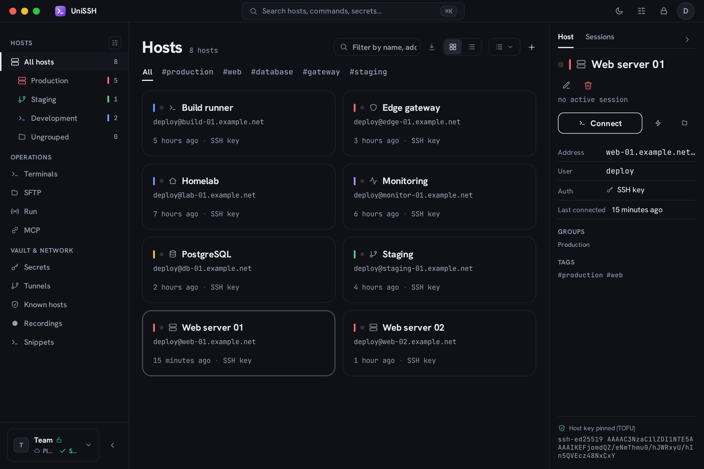
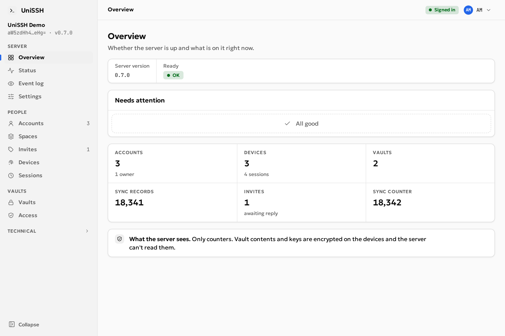

# UniSSH screenshots

UniSSH v0.7.0 in light and dark mode, with English UI and demo data.
Browser captures at 2× scale; the client uses macOS-style window controls.

| Screen | Dark | Light |
| --- | --- | --- |
| Host library — colours, icons, groups, and connection details | [View](hosts-dark.png) | [View](hosts-light.png) |
| Terminal — an SSH session | [View](terminal-dark.png) | [View](terminal-light.png) |
| SFTP — local and remote file panes | [View](sftp-dark.png) | [View](sftp-light.png) |
| MCP — application access and command activity | [View](mcp-dark.png) | [View](mcp-light.png) |
| Administration — server overview | [View](admin-dark.png) | [View](admin-light.png) |
| Administration — accounts | [View](admin-accounts-dark.png) | [View](admin-accounts-light.png) |
| Administration — audit log | [View](admin-audit-dark.png) | [View](admin-audit-light.png) |

## Earlier releases

The following screenshots predate v0.7.0 and show earlier interface versions:
[Broadcast](broadcast-dark.png), [Fleet exec](fleet-exec-dark.png),
[secrets](secrets-dark.png), [tunnels](tunnels-dark.png),
[known hosts](known-hosts-dark.png), [recordings](recordings-dark.png),
and [snippets](snippets-dark.png).
